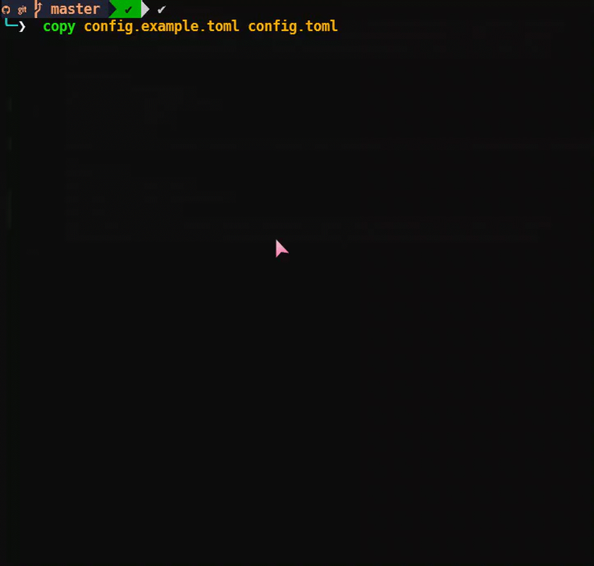

# sshtether

[](https://github.com/cumulus13/sshtether/actions/workflows/ci.yml)
[](https://crates.io/crates/sshtether)
[](LICENSE)

<p align="center">
  
</p>

<p align="center">
  
</p>

A remote command runner over SSH that **stays tethered**. Run any command on a
server with a real terminal (PTY, colours, UTF-8, window resizing) and let
`sshtether` deal with everything that breaks a plain `ssh`: failed connects,
dropped links, silent network death, sleeping laptops, rebooting servers.

It is a pure-Rust, single-binary port of a Python script (`rcmd.py`), with the
same behaviour plus a guarantee the original lacked: **it never piles up
duplicate processes** (see [Single instance](#single-instance-no-duplicate-processes)).

* **Auto-reconnect** with exponential backoff, jitter and multi-server failover
* **Dead-peer detection** in seconds (SSH heartbeat + TCP keepalive)
* **Real terminal**: raw mode, colours, window resize, `~.` escape
* **One instance only**: a reconnect stops the previous process first
* **Safe by default**: host keys verified, changed keys always refused
* **Cross-platform**: Linux, macOS, Windows (x86-64 and ARM64)
* **No OpenSSL, no system `ssh`**: pure Rust ([`russh`](https://crates.io/crates/russh))

## Install

```sh
cargo install sshtether
```

Or download a prebuilt binary from the
[Releases](https://github.com/cumulus13/sshtether/releases) page (Linux, macOS,
Windows; each archive ships with a `.sha256`). Building from source needs
Rust 1.89 or newer.

## Quick start

```sh
# one host, no config file
sshtether -H 203.0.113.10 -u root -i ~/.ssh/id_ed25519 htop

# several arguments are quoted for you; a single argument is a shell line
sshtether -H myhost -- journalctl -u nginx -f
sshtether -H myhost "ls -la /var/log | tail"

# keep a long job alive on the server even if the link dies
sshtether -H myhost --persist tmux -- ./long-job.sh

# servers from a config file (see below), fail over automatically
sshtether tmux attach -t main
```

Type `Enter` then `~.` to disconnect and quit; `~?` shows help; `~~` sends a
literal `~`.

## Configuration

`sshtether` reads the first of these that exists (or the one given with
`--config`): `$SSHTETHER_CONFIG`, `~/.config/sshtether/config.{toml,json}`, and
the platform config directory (`%APPDATA%\sshtether` on Windows,
`~/Library/Application Support/sshtether` on macOS).

```toml
[[server]]
name     = "Primary"
hostname = "203.0.113.10"
username = "root"
port     = 22
key_file = "~/.ssh/id_ed25519"

[[server]]
name      = "Backup"
hostname  = "backup.example.com"
username  = "deploy"
key_files = ["~/.ssh/id_ed25519", "~/.ssh/id_rsa"]
```

JSON works too (`{"servers": [ { ... } ]}`). `host`/`user`/`identity` are
accepted as aliases. Paths expand `~`, `$VAR`, `${VAR}` (and `%VAR%` on
Windows). Unknown keys are rejected, so a typo such as `usernme` is an error
rather than a silent default. See [`config.example.toml`](config.example.toml).

### Authentication

Tried in this order: every configured key file, then the ssh-agent and the
default `~/.ssh/id_ed25519|id_ecdsa|id_rsa` keys (skip with `--no-agent`), then
the password.

| Variable | Purpose |
|----------|---------|
| `SSHTETHER_PASSWORD` | Password (prefer this over writing it in the config) |
| `SSHTETHER_KEY_PASSPHRASE` | Passphrase for encrypted key files; otherwise you are prompted once |
| `SSHTETHER_CONFIG` | Path to the config file |
| `NO_COLOR` | Disable coloured diagnostics |

Authentication failures and host-key problems are *permanent*: that server is
disabled for the rest of the run instead of being retried forever.

## Single instance (no duplicate processes)

A naive reconnect loop starts the command again while the previous process is
still running on the server, because `sshd` often needs minutes to notice a
half-dead connection. Every reconnect then adds one more copy, and a flapping
link can exhaust a machine.

`sshtether` prevents this. Each run gets a random id, and the remote command is
started through a tiny POSIX `sh` wrapper that records its pid under
`$TMPDIR/sshtether-<uid>/`. On reconnect the new wrapper first terminates the
lingering process group of **the same run's** previous connection (and only if
the pid is still alive *and* its command line carries the run id, so a recycled
pid is never touched), then starts the command. Other runs, other users and
unrelated processes are never affected. Locally, the old connection is always
closed and its tasks aborted before a new one is opened, so one `sshtether`
process holds at most one connection.

Use `--allow-duplicates` to turn the takeover off.

## Options

```text
Retry:       -r, --retry <max|infinity|0|1>   -m, --max-retries <N>
             -d, --delay <SECS>               --max-delay <SECS>     --no-rerun
Target:      -c, --config <FILE>   -H, --host <HOST>   -u, --user <USER>
             -p, --port <PORT>     -i, --identity <FILE>  (repeatable)
Connection:  -t, --connect-timeout <SECS>     --keepalive <SECS>   --keepalive-max <N>
             --host-key-policy <accept-new|strict|insecure>
             --known-hosts <FILE>             --no-agent
Session:     --persist <none|tmux|screen>     --session-name <NAME>
             --allow-duplicates               --term <TERM>        --lang <LANG>
Output:      -v, --verbose    -q, --quiet
```

Run `sshtether --help` for details.

### Exit codes

| Code | Meaning |
|------|---------|
| *n* | The remote command's own exit status (signals map to `128 + n`) |
| 0 | You detached with `~.` |
| 1 | Local, non-retryable error (bad config, key problem, ...) |
| 130 | Ctrl+C while not attached to the remote |
| 255 | Gave up connecting, `--no-rerun` after a drop, or no usable servers |

## Behaviour notes

* **Re-running**: a command that is not resumable restarts from scratch after a
  reconnect (a warning says so). Use `--persist tmux|screen`, or run
  `tmux`/`screen` yourself, to resume instead. A session that lived at least 15 s
  resets the backoff.
* **Dead links** are detected after roughly `--keepalive` × (`--keepalive-max` + 1)
  seconds (default about 20 s), and on Linux additionally by `TCP_USER_TIMEOUT`.
* **Host keys**: `accept-new` (default) saves unknown hosts and refuses changed
  keys; `strict` refuses unknown hosts; `insecure` accepts unknown hosts without
  saving them. A *changed* key is refused under every policy.
* **Non-interactive stdin**: `echo data | sshtether cat` works; end-of-file is
  forwarded as Ctrl-D. Ctrl+C then cancels locally.

## Library

The building blocks (`config`, `connection`, `session`, `supervisor`,
`command`, `terminal`, `escape`) are public; see [docs.rs](https://docs.rs/sshtether).

## Development

```sh
cargo fmt --all --check
cargo clippy --all-targets -- -D warnings
cargo test            # unit tests + end-to-end tests against an in-process SSH server
```

The end-to-end suite spins up a `russh` server and covers exit codes, host-key
policies, key and password auth, failover, reconnect after an abrupt drop,
heartbeat detection of a frozen link, and connection-leak checks.

## License

[MIT](LICENSE) © Hadi Cahyadi


## 👤 Author
        
[Hadi Cahyadi](mailto:cumulus13@gmail.com)
    

[](https://www.buymeacoffee.com/cumulus13)

[](https://ko-fi.com/cumulus13)
 
[Support me on Patreon](https://www.patreon.com/cumulus13)